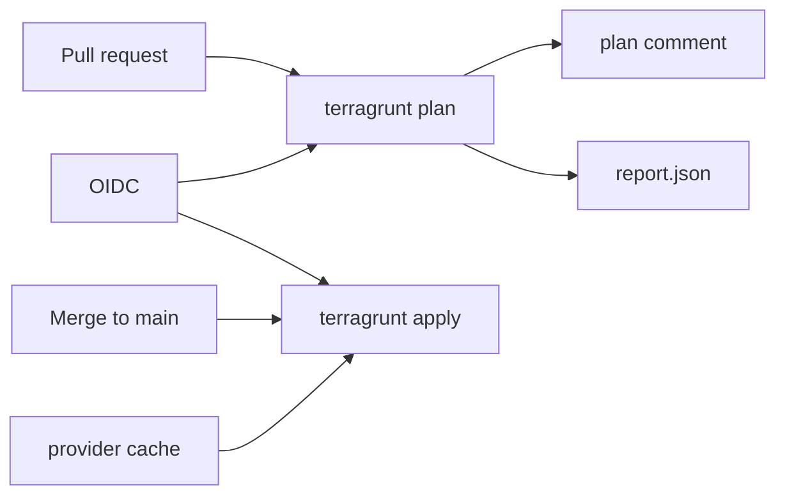

# 10.1 Design

Sketch the pipeline before any workflow runs. A pull request plans. The merge to `main` applies. This lecture stays on local files. No AWS account.

## Goal

From `start/`, make `./check.sh` pass.

Four files record the design:

| File | What it records |
| --- | --- |
| `design.md` | Triggers, commands, auth, and state |
| `diagram.mmd` | The same path as a flowchart |
| `sample/root.hcl` | The local backend the pipeline would run |
| `sample/.github/workflows/pipeline.yml` | The two jobs, as a sketch |

The checker renders `sample/dev` and `sample/prod`. It does not apply, and it does not run the workflow.

## The two jobs

| | Plan | Apply |
| --- | --- | --- |
| When | `pull_request` | `push` to `main`, which is what a merge produces |
| Command | `terragrunt --non-interactive run --all --report-file report.json -- plan -input=false` | `terragrunt --non-interactive run --all --provider-cache -- apply -input=false` |
| Extra output | `report.json`, then a comment on the pull request | The provider cache, so each provider is downloaded once |
| Auth | OIDC, introduced here and filled in by lecture 10.2 | The apply role, which the pull request cannot assume |

A pull request is still a proposal. Apply waits until that proposal is the commit on `main`. The plan comment sits on the pull request, next to the diff. `cancel-in-progress` stays false on the shared workflow so a second push does not cancel an apply that has already started. Lecture 10.3 gives the plan job its own group, and that group may cancel.

`--non-interactive` answers Terragrunt's own prompts. `run --all` queues every unit under the working directory. `--` keeps the Terraform arguments (`plan`, `-input=false`) on the Terraform side.

## Auth and state

GitHub mints a short-lived token. The workflow's permission is `id-token: write`. The repository does not store `AWS_ACCESS_KEY_ID` or `AWS_SECRET_ACCESS_KEY`. Lecture 10.2 is where the role trust is written.

This sample uses the local backend from lecture 05.1, so later lectures run without an account. A real account uses the S3 backend from lecture 05.2. Either way the key is one state file per unit:

```text
state/${path_relative_to_include()}/terraform.tfstate
```

## Layout

```text
start/
  design.md
  diagram.mmd
  check.sh
  sample/
    root.hcl
    .github/workflows/pipeline.yml
    modules/record/
    dev/terragrunt.hcl
    prod/terragrunt.hcl
```

`sample/` is the repository the sketch describes. The workflow file is what that repository would commit at `.github/workflows/pipeline.yml`.

## Steps

1. Install the pinned CLIs if you have not (lecture 02.1). `terraform_binary = "terraform"` in `sample/root.hcl` keeps the engine on Terraform 1.17 when `tofu` is on `PATH`.
2. Replace the TODOs in `start/design.md` with:

```markdown
# Pipeline design

## Plan

- Trigger: `pull_request`
- Command: `terragrunt --non-interactive run --all --report-file report.json -- plan -input=false`
- Comment: post `plan-comment.md` on the pull request
- Report: `report.json` from `--report-file`

## Apply

- Trigger: `push` to `main` after the pull request merges
- Command: `terragrunt --non-interactive run --all --provider-cache -- apply -input=false`
- Cache: Terragrunt provider cache (`--provider-cache`)

## Auth

- Method: GitHub Actions OIDC (`id-token: write`)
- Stored keys: none

## State

- Lab backend: `local`
- Key: `state/${path_relative_to_include()}/terraform.tfstate`
```

3. Replace `start/diagram.mmd` with:



Save the diagram without the `mermaid` fence. The file's first line is `flowchart LR`.

4. Replace the TODO in `start/sample/root.hcl` with:

```hcl
path = "${get_parent_terragrunt_dir()}/state/${path_relative_to_include()}/terraform.tfstate"
```

Keep `backend = "local"`. Leave `terraform_binary` in `root.hcl`.

5. Replace `start/sample/.github/workflows/pipeline.yml` with the two jobs. Plan runs only on `pull_request`. Apply runs only when `github.ref` is `refs/heads/main`. Permissions are `contents: read`, `id-token: write`, and `pull-requests: write`. `cancel-in-progress` is `false`. Checkout is `actions/checkout@v7.0.1`. The finished file is [`solution/sample/.github/workflows/pipeline.yml`](solution/sample/.github/workflows/pipeline.yml).

6. From `start/sample/dev`, then from `start/sample/prod`:

```bash
terragrunt run -- version
terragrunt render
```

The version line is Terraform 1.17.x. Dev's rendered key ends in `state/dev/terraform.tfstate`. Prod's ends in `state/prod/terraform.tfstate`. Both notes are `ci design`.

7. From `start/`, run:

```bash
./check.sh
```

The last lines are:

```text
PASS  10.1 design
AWS was not contacted. This lecture stops at the design and the rendered config.
```

The checker needs `python3` and PyYAML (`python3 -c 'import yaml'`). On Debian and Ubuntu that package is `python3-yaml`.

The lock file next to each unit pins `local` 2.9.1, `null` 3.3.2, and `random` 3.9.1. The checker validates inputs and does not apply, so it does not need those providers downloaded.

## If the checker stops early

- A line that still says `TODO` is a blank the snippet above replaces.
- `hcl fmt --check` fails when `root.hcl` is not aligned with the snippet. From `start/`, run `terragrunt hcl fmt`, then run the checker again.
- `OpenTofu` from `terragrunt run -- version` means `terraform_binary` did not stay in `sample/root.hcl`.
- The rendered path is absolute. It is `<lecture>/sample/state/<unit>/terraform.tfstate`, from `get_parent_terragrunt_dir()`.

Compare your files with `solution/`. What the checker prints is written up in [`solution/NOTES.md`](solution/NOTES.md).
